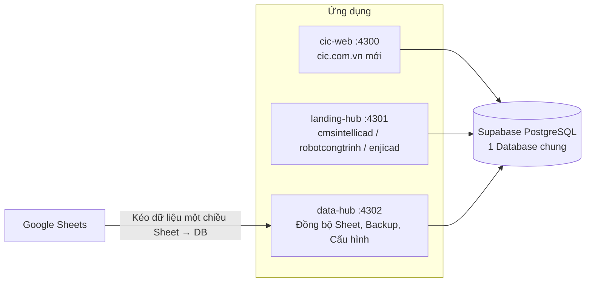

# Báo cáo: Gộp các website CIC về chung 1 mã nguồn + 1 Database (Supabase Self-host)

- **Ngày lập:** 22/10/2026
- **Môi trường hiện tại:** Máy cá nhân (local) — chuẩn bị chuyển lên máy chủ Viettel IDC
- **Database đích:** Supabase Self-host (PostgreSQL) — `127.0.0.1:54322`

---

## 1. Kết luận

Sau khi rà soát toàn bộ 18 thư mục website trong `d:\web-data`, **phạm vi gộp đợt này gồm 4 website**:

| # | Website | Loại | Ứng dụng phục vụ sau khi gộp | Cổng local |
|---|---|---|---|---|
| 1 | **cmsintellicad.vn** (Tiếng Việt + Tiếng Anh) | Landing page | `landing-hub` | `4301` |
| 2 | **robotcongtrinh.vn** | Landing page | `landing-hub` | `4301` |
| 3 | **enjicad.vn** | Landing page | `landing-hub` | `4301` |
| 4 | **cic.com.vn (bản mới — `cic-web`)** | Cổng thông tin chính | `cic-web` | `4300` |

Kèm theo là **1 ứng dụng quản trị dữ liệu mới**: `data-hub` (cổng `4302`) — kéo dữ liệu Google Sheet về Database, sao lưu, cấu hình trên Web.

Các website còn lại **chưa đưa vào phạm vi** (lý do tại mục 5).

---

## 2. Kiến trúc sau khi gộp

| Thành phần | Cổng | Vai trò |
|---|---|---|
| Supabase PostgreSQL | `54322` | Database dùng chung cho cả 3 ứng dụng |
| Supabase Studio | `54323` | Giao diện xem / sửa bảng |
| Supabase Kong (API, Auth) | `8000` | REST API & xác thực |
| `cic-web` | `4300` | cic.com.vn mới |
| `landing-hub` | `4301` | 1 mã nguồn phục vụ các landing page theo tên miền |
| `data-hub` | `4302` | Quản trị dữ liệu Sheet → DB |

> Đã chuyển hết khỏi cổng `3000`/`3001` để tránh xung đột trên máy.

**Nguyên tắc tách dữ liệu trong 1 DB:** bảng `cic_sites` quản lý danh sách site; các bảng dùng chung (`cic_forms`, `cic_content_pages`) có cột `site_id`. Dữ liệu cic.com.vn có `site_id IS NULL`, landing page có `site_id` riêng → không lẫn nhau.

---

## 3. Chi tiết từng website trong phạm vi

### 3.1. cmsintellicad.vn

| Mục | Trước khi gộp | Sau khi gộp |
|---|---|---|
| Mã nguồn | Laravel + Vite | Phục vụ nguyên bản HTML/CSS/JS gốc qua `landing-hub` |
| Database | **Không có DB** — form đẩy thẳng ra Google Sheet | Nội dung lưu bảng `cic_content_page_sections` (17 section VI + 16 section EN), sửa tại `/admin` có bản nháp / xuất bản / khôi phục phiên bản |
| Form đăng ký | Ghi vào Google Sheet | Ghi thẳng vào PostgreSQL (`/api/forms/cms-intellicad`) |
| Dữ liệu cũ trên Sheet | Tab `LADIPAGE`, `CMS INTELLICAD LISP` | Đã kéo về DB: **61 dòng** + **1 dòng**, tự đồng bộ định kỳ |
| Đường dẫn local | | `http://localhost:4301/_sites/cms-intellicad` · `…/_sites/cms-intellicad-en` |

### 3.2. robotcongtrinh.vn

| Mục | Trước khi gộp | Sau khi gộp |
|---|---|---|
| Mã nguồn | Laravel, nội dung lưu file `storage/app/content.json` | Phục vụ nguyên bản giao diện gốc qua `landing-hub` |
| Database | **Không có DB** — form đẩy thẳng ra Google Sheet | Nội dung đã chuyển vào `cic_content_page_sections` (10 section), sửa tại `/admin` |
| Form đăng ký | Ghi vào Google Sheet | Ghi thẳng vào PostgreSQL |
| Dữ liệu cũ trên Sheet | Tab `Landing Page` | Đã kéo về DB: **3 dòng**, tự đồng bộ định kỳ |
| Đường dẫn local | | `http://localhost:4301/_sites/robot-cong-trinh` |

### 3.3. enjicad.vn

| Mục | Trước khi gộp | Sau khi gộp |
|---|---|---|
| Mã nguồn | PHP, **dùng chung DB với cic cũ** | Trang HTML tĩnh qua `landing-hub` |
| Bảo mật | `index.php` bị chèn **153 dòng mã độc spam tiếng Nhật** | Đã làm sạch |
| Form đăng ký | Theo hệ thống cic cũ | Ghi thẳng vào PostgreSQL qua `landing-form-bridge.js` |
| Chỉnh sửa | | Sửa được Hotline, Zalo, link tải, SEO tại `data-hub` → Websites. Nội dung chữ trong trang sửa trực tiếp file HTML |
| Đường dẫn local | | `http://localhost:4301/_sites/enjicad` |

> ⚠️ Thư mục gốc `enjicad.vn` nặng ~3,9 GB, chủ yếu là file tải về. Cần xác nhận file nào còn dùng trước khi đưa lên máy chủ.

### 3.4. cic.com.vn mới (`cic-web`)

| Mục | Nội dung |
|---|---|
| Mã nguồn | Next.js (đã viết mới, thay thế PHP CMS cũ) |
| Database | Đã clone **88 bảng + dữ liệu + `auth.users`** từ Supabase Cloud về Supabase Self-host |
| Bổ sung | 4 migration: `cic_sites`, đồng bộ Sheet (`cic_sheet_*`), sao lưu (`cic_backups`), quyền RBAC mới |
| Đường dẫn local | `http://localhost:4300` |

---

## 4. Ứng dụng quản trị dữ liệu `data-hub` (`:4302`)

Mục đích duy nhất: **kéo dữ liệu Google Sheet về Database (một chiều Sheet → DB)**, lưu lịch sử, sao lưu. Không làm CRM/CSKH.

| Trang | Chức năng |
|---|---|
| `/` Tổng quan | Quy trình 3 bước, danh sách nguồn Sheet, nút “Kéo dữ liệu mới nhất” |
| `/sheets` Nguồn Sheet | Dán link Sheet → đọc danh sách Tab → chọn → lưu. Sửa dòng tiêu đề, cột khóa, chu kỳ đồng bộ, bật/tắt |
| `/data` Dữ liệu | Bảng cột động theo từng Sheet, tìm kiếm, lọc dòng đã xóa trên Sheet, lịch sử từng dòng, khôi phục 1 click, xuất Excel/CSV |
| `/sites` Websites | Tên miền, trạng thái bảo trì, Hotline, email nhận thông báo, GTM, Facebook Pixel, link tải, SEO |
| `/backups` Sao lưu | Tạo / tải bản sao lưu DB và dữ liệu Sheet |
| `/settings` Cấu hình | Tải lên Google Service Account JSON, chu kỳ đồng bộ, tự động backup, SMTP |

**Trường dữ liệu linh hoạt:** mỗi Sheet có cấu trúc cột khác nhau → lưu dạng `JSONB` + `column_schema` riêng cho từng nguồn, không cần sửa DB khi thêm Sheet mới.

**Yêu cầu quyền truy cập Sheet:** Sheet phải được share quyền **Viewer** cho email Service Account. Nếu chủ Sheet không cho share, các phương án thay thế:

| Phương án | Trạng thái |
|---|---|
| Sheet trung gian dùng `IMPORTRANGE` (chỉ share Sheet trung gian) | Dùng được ngay |
| Form landing ghi thẳng DB, bỏ Sheet | Đã áp dụng cho 3 landing trong phạm vi |
| Apps Script đẩy dữ liệu sang Data Hub | Chưa làm (cần Data Hub có địa chỉ public) |
| Tải file Excel/CSV lên thủ công | Chưa làm |

---

## 5. Các website chưa đưa vào phạm vi

| Website | Hiện trạng | Lý do chưa gộp |
|---|---|---|
| allplan, bim.cic.com.vn | Đang lưu trữ & deploy trên **Ladipage** | Mã nguồn nằm trên Ladipage, chỉ có bản HTML lưu lại |
| escon.cic.com.vn | HTML tĩnh, form gửi **GetResponse**; `email.php` còn code test nên không gửi mail | Chưa thống nhất đưa vào |
| revit.cic.com.vn | HTML tĩnh, form gọi `ajaxserver/serverfile.php` **không tồn tại** (form đang hỏng) | Chưa thống nhất đưa vào |
| enjicad.cic.com.vn, vietnambim.cic.com.vn | Chỉ là trang mặc định Plesk | Chưa có website |
| nghenoithat.cic.com.vn | Thư mục rỗng | Chưa có website |
| techaz | Cùng bộ PHP CMS với cic cũ, MySQL 110 bảng, ~3,1 GB | Khối lượng lớn, cần làm riêng |
| nghenoithat.vn, vietnambim.com | Laravel 6 + MySQL, quy mô nhỏ | **Chưa có file dump DB** |
| app.netzero2050.vn | Laravel 9, 154 route, 31 bảng — là ứng dụng thật | Nên giữ mã nguồn riêng; file dump hiện gần như rỗng |
| netzero2050.vn | **WordPress**, 71 bảng | WordPress cần MySQL, không nên chuyển sang PostgreSQL |
| dskh.cic.com.vn | PHP 5 + MySQL riêng DB `danhsachkh` (xem mục 6) | Là công cụ CSKH, ngoài phạm vi |

> Lưu ý: escon, revit, allplan, bim đã có bản chạy thử trong `landing-hub` nhưng **không tính vào phạm vi đợt này**.

---

## 6. Phát hiện về `dskh.cic.com.vn`

- Dùng **DB MySQL riêng `danhsachkh`** (user `admin_dskh`), **không nằm trong DB cic cũ** (`cic14005_cic_fs.sql` không có các bảng này).
- Hầu hết file kết nối `localhost`; riêng `addcustomer.php` kết nối tới máy chủ MySQL **`dutoancic.vn`** → DB nhiều khả năng nằm trên hosting của dutoancic.vn.
- 3 bảng: `danhsachkh_download` (khách tải phần mềm), `ghichu` (ghi chú nội bộ), `EsconOnlineUser` (đếm máy đang mở phần mềm Escon).
- **Rủi ro:**
  - `usercounter.php` có thể đang được phần mềm Escon gọi về → không được tắt / đổi URL nếu chưa xác nhận.
  - Code PHP 5 (`mysql_*`), lỗi SQL injection, lộ Google OAuth client secret trong `index.php` → **nên đổi secret ngay**.

---

## 7. Kiểm thử đã thực hiện

| Hạng mục | Kết quả |
|---|---|
| HTTP 200 các trang `data-hub` (`/`, `/data`, `/sheets`, `/sites`, `/backups`, `/settings`) | ✅ |
| HTTP 200 landing: `cms-intellicad`, `cms-intellicad-en`, `robot-cong-trinh`, `enjicad` | ✅ |
| Unit test đồng bộ Sheet (`vitest`) | ✅ 5/5 |
| Kiểm tra schema (`verify:schema`) | ✅ |
| Kiểm thử E2E (tách `site_id`, đồng bộ Sheet, khôi phục dòng, backup) | ✅ |
| So sánh giao diện từng pixel với web gốc | ⏳ Chưa — cần kiểm tra bằng mắt |
| Gửi thử form thật trên trình duyệt từng landing | ⏳ Chưa |

---

## 8. Việc cần làm tiếp

| # | Việc | Người thực hiện |
|---|---|---|
| 1 | Kiểm tra giao diện 3 landing so với web gốc, gửi thử form | Anh / em |
| 2 | Xác nhận các file tải về còn dùng trong `enjicad.vn` (3,9 GB) | Anh |
| 3 | Đổi Google OAuth client secret đang lộ ở `dskh` | Anh |
| 4 | Chuẩn bị máy chủ Viettel: Docker, tên miền, SSL — theo [DEPLOY_SERVER.md](./DEPLOY_SERVER.md) | Anh / em |
| 5 | Trỏ DNS `cmsintellicad.vn`, `robotcongtrinh.vn`, `enjicad.vn`, `cic.com.vn` về máy chủ mới | Anh |
| 6 | (Đợt sau) Xem xét gộp techaz, nghenoithat.vn, vietnambim.com khi có dump DB | — |

**Tài liệu liên quan:** [DEPLOY_SERVER.md](./DEPLOY_SERVER.md) · [SHEET_ONBOARDING.md](./SHEET_ONBOARDING.md)
